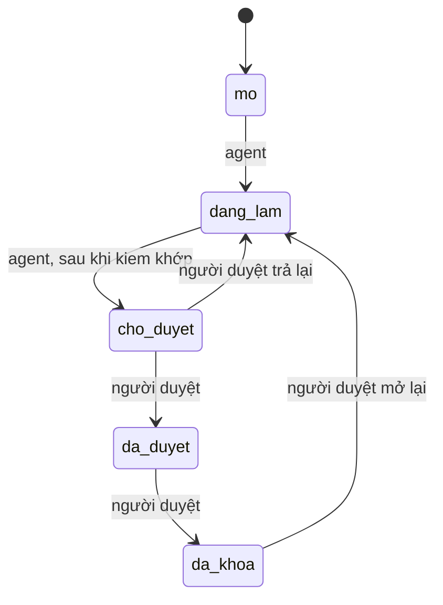

# Hồ sơ

Mỗi khách hàng một thư mục theo MST, mỗi kỳ một thư mục con. Hồ sơ nằm trên máy của công ty, không đưa vào git và không đưa lên dịch vụ chia sẻ. Đường gốc đặt bằng biến môi trường `KETOAN_ROOT` hoặc cờ `--root`.

```
$KETOAN_ROOT/<MST>/khach-hang.json        MST, tên, chế độ kế toán
$KETOAN_ROOT/<MST>/<YYYY-MM>/nhan/        tệp đầu vào, không sửa sau khi nhận
$KETOAN_ROOT/<MST>/<YYYY-MM>/lam/         bảng đối chiếu, ghi chú của agent
$KETOAN_ROOT/<MST>/<YYYY-MM>/day-vao/     tệp Excel để nhập vào Smart Pro bằng F8-F
$KETOAN_ROOT/<MST>/<YYYY-MM>/bang-bam.tsv SHA-256 của từng tệp trong nhan/
$KETOAN_ROOT/<MST>/<YYYY-MM>/trang-thai.tsv lịch sử trạng thái kỳ
$KETOAN_ROOT/<MST>/<YYYY-MM>/nhat-ky.tsv  nhật ký quyết định
```

Mọi lệnh chạy bằng `node skill://ho-so/scripts/hoso.mjs <lệnh>`. Chỉ script này ghi vào các tệp `.tsv` và `khach-hang.json`.

| Lệnh | Việc |
|---|---|
| `init <MST> --ten <tên> --che-do <TT99\|TT133\|TT152>` | Tạo hồ sơ khách hàng |
| `ky <MST> <YYYY-MM>` | Tạo thư mục kỳ, trạng thái `mo` |
| `nhan <MST> <YYYY-MM> <tệp...>` | Chép tệp vào `nhan/` và ghi mã băm. Nhận lại cùng tệp không ghi thêm. Cùng tên khác nội dung thì từ chối. |
| `kiem <MST> <YYYY-MM>` | Kiểm tra `nhan/` khớp mã băm. Mã thoát 1 nếu có tệp bị sửa, thiếu hoặc lạ. |
| `chuyen <MST> <YYYY-MM> <trạng thái> --nguoi <tên>` | Chuyển trạng thái kỳ |
| `trang-thai <MST> <YYYY-MM>` | In trạng thái hiện tại |
| `ghi <MST> <YYYY-MM> <phase> <decision> <why> <evidence> <result>` | Thêm một dòng nhật ký |

## Trạng thái kỳ



Các bước của người duyệt đòi gõ lại MST trên terminal. Agent không được làm thay. Lệnh `nhan` bị chặn khi kỳ ở `cho-duyet`, `da-duyet` hoặc `da-khoa`.

Mã thoát: 0 thành công, 1 bị từ chối hoặc không khớp, 2 sai cú pháp, 3 cần người duyệt.
